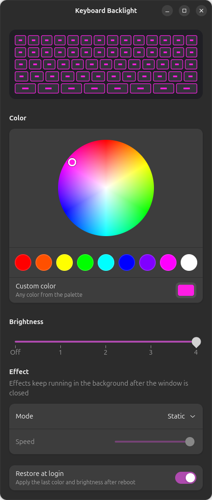
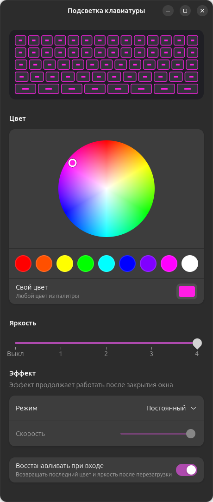

# mechrevo-kbd

[](https://github.com/Plutarxi99/mechrevo-kbd/actions/workflows/build.yml)

RGB keyboard backlight control for **MECHREVO** laptops on Linux — a small kernel module,
a GTK4/libadwaita app and a `kbd-color` command.

MECHREVO laptops are built on Uniwill barebones. Linux 7.0 does not expose their keyboard
backlight, and `tuxedo-drivers` refuses to load on non-TUXEDO machines, so the color can only
be changed from the Windows app. This project fills that gap.

<p align="center"></p>

[Русская версия](#по-русски) · [中文说明](#中文说明)

### Is this for you?

- Your MECHREVO (e.g. WUJIE 15) keyboard backlight is stuck on one color under Linux
- You want to **change the keyboard RGB color on Linux** (Ubuntu, Fedora, Arch…) without booting Windows
- Fn keys change brightness but there is no way to pick a color
- `tuxedo-drivers` / `tuxedo-control-center` says your laptop is not supported
- You want breathing, blinking or rainbow keyboard effects on Linux

## Supported hardware

| Laptop | Board | Status |
|---|---|---|
| MECHREVO WUJIE15XA | WUJIE15-GX5HRXG (Ryzen 7 8745HS) | ✅ works |
| Other MECHREVO | | should work, please report |
| Other Uniwill-based laptops (single-zone RGB) | | try `--force`, please report |

Please [report your laptop](https://github.com/Plutarxi99/mechrevo-kbd/issues/new?template=device-report.yml),
whether it works or not.

**Requirements:** a recent kernel (developed on Linux 7.0; CI builds against the Ubuntu 24.04
kernel), DKMS and kernel headers, Python 3 with GTK 4 and libadwaita for the app.

The module refuses to load unless the embedded controller reports a single-zone RGB keyboard.
At load time it only reads the EC; it writes the color, brightness and "apply" registers and
nothing else, and only when you change the backlight.

## Install

```sh
# Debian/Ubuntu dependencies
sudo apt install dkms linux-headers-$(uname -r) python3-gi gir1.2-gtk-4.0 gir1.2-adw-1

git clone https://github.com/Plutarxi99/mechrevo-kbd.git
cd mechrevo-kbd
sudo ./install.sh            # MECHREVO
sudo ./install.sh --force    # other Uniwill-based laptops
```

DKMS rebuilds the module automatically after kernel updates.

### Secure Boot

With Secure Boot on, the kernel only loads modules signed by a key the firmware trusts.
DKMS signs the module with its own key; if `install.sh` reports that the module could not be
loaded, enroll that key once:

```sh
sudo mokutil --import /var/lib/shim-signed/mok/MOK.der   # asks for a one-time password
sudo reboot
```

On the blue **MOK Manager** screen press any key right away, then
*Enroll MOK → Continue → Yes*, enter the password and reboot.

## Usage

Open **Keyboard Backlight** from the app menu, or use the command line:

```sh
kbd-color                 # show color and brightness
kbd-color purple          # red orange yellow green cyan blue purple magenta white
kbd-color ff8800          # hex
kbd-color 255 100 0       # decimal, 0–255 per channel
kbd-color -b 2            # brightness 0–4, 0 = off
kbd-color effect breathing 5   # static | breathing | blink | cycle | rainbow, speed 1–10
kbd-color effect static        # back to a plain color
```

The app has a color wheel, presets, brightness and an effect picker with a live preview.

**Effects.** *Rainbow* is drawn by the keyboard controller itself (experimental: it uses an
EC bit that is documented but not yet confirmed on every model). *Breathing*, *blink* and
*color cycle* are drawn by `mechrevo-kbd-effects`, a small user service (~20 updates per second)
that keeps running after the app is closed and survives reboots until you pick *Static*.

The last color is restored at login (`kbd-color-restore.service`, can be switched off in the app).

The LED is a standard multicolor LED, so any tool can drive it:

```sh
echo "255 0 0" > /sys/class/leds/mechrevo_kbd:rgb:kbd_backlight/multi_intensity
echo 4         > /sys/class/leds/mechrevo_kbd:rgb:kbd_backlight/brightness
```

## How it works

The EC is accessed through the ACPI methods `\_SB.INOU.ECRR` / `ECRW`, the same path the
mainline `uniwill-laptop` driver uses. The register layout follows the keyboard backlight
support that was added to that driver after Linux 7.0:

| Register | Meaning |
|---|---|
| `0x0766` bit 2 | EC reports an RGB keyboard |
| `0x0769`–`0x076B` | red, green, blue, 0–50 |
| `0x0767` bit 5 | apply color |
| `0x078C` bits 7:5, bit 4 | brightness 0–4, apply |
| `0x0767` bit 7 | hardware rainbow effect (`/sys/devices/platform/mechrevo_kbd/rainbow`) |

Once your kernel's `uniwill-laptop` supports your model, prefer it and uninstall this project.

## Uninstall

```sh
sudo ./uninstall.sh
```

The DKMS signing key stays enrolled in MOK; remove it with `sudo mokutil --delete <key.der>` if
you no longer need it.

## Contributing

Device reports, bug reports, ideas and pull requests are welcome — see
[CONTRIBUTING.md](CONTRIBUTING.md). Questions go to
[Discussions](https://github.com/Plutarxi99/mechrevo-kbd/discussions).

## Disclaimer

This is an independent project, not affiliated with MECHREVO, Uniwill or TUXEDO. It talks to the
laptop's embedded controller; it only touches the keyboard backlight registers listed above, but
use it at your own risk.

## License

GPL-2.0, see [LICENSE](LICENSE).

---

## По-русски

Управление RGB-подсветкой клавиатуры ноутбуков **MECHREVO** в Linux: модуль ядра,
приложение на GTK4/libadwaita и команда `kbd-color`.

**Вам сюда, если:**

- подсветка клавиатуры MECHREVO (например, WUJIE 15) в Linux горит одним цветом и не меняется;
- нужно **поменять цвет подсветки клавиатуры в Linux** (Ubuntu, Fedora, Arch…) без Windows;
- яркость клавишами Fn меняется, а цвет выбрать негде;
- `tuxedo-drivers` / TUXEDO Control Center пишет, что ноутбук не поддерживается;
- хочется эффектов: дыхание, мигание, радуга.

<p align="center"></p>

**Установка:**

```sh
sudo apt install dkms linux-headers-$(uname -r) python3-gi gir1.2-gtk-4.0 gir1.2-adw-1
git clone https://github.com/Plutarxi99/mechrevo-kbd.git
cd mechrevo-kbd
sudo ./install.sh            # для MECHREVO
sudo ./install.sh --force    # для других ноутбуков на базе Uniwill
```

**Secure Boot.** Если `install.sh` пишет, что модуль не загрузился, один раз зарегистрируйте ключ DKMS:
`sudo mokutil --import /var/lib/shim-signed/mok/MOK.der`, затем перезагрузка. На синем экране
сразу нажмите любую клавишу → *Enroll MOK → Continue → Yes* → пароль → *Reboot*.

**Использование:** приложение «Подсветка клавиатуры» в меню (круг цвета, готовые цвета, яркость,
эффекты) или `kbd-color red`, `kbd-color ff8800`, `kbd-color -b 0..4`,
`kbd-color effect breathing 5` (`static`, `breathing`, `blink`, `cycle`, `rainbow`).
Радугу рисует сам контроллер клавиатуры, остальные эффекты — фоновая служба
`mechrevo-kbd-effects`. Последний цвет восстанавливается при входе в систему.

Радуга экспериментальная: она использует бит контроллера, который подтверждён не на всех моделях.

**Удаление:** `sudo ./uninstall.sh`.

Если у вас другой ноутбук MECHREVO или Uniwill, сообщите, работает ли всё,
[через шаблон issue](https://github.com/Plutarxi99/mechrevo-kbd/issues/new?template=device-report.yml).

Хотите помочь — отчёты о моделях, ошибки, идеи и pull request'ы приветствуются, подробности в
[CONTRIBUTING.md](CONTRIBUTING.md#как-помочь-проекту). Вопросы — в
[Discussions](https://github.com/Plutarxi99/mechrevo-kbd/discussions).

Проект независимый и не связан с MECHREVO, Uniwill или TUXEDO. Модуль пишет только в регистры
подсветки клавиатуры, но используете вы его на свой риск.

---

## 中文说明

在 Linux 下控制 **机械革命（MECHREVO）** 笔记本的 RGB 键盘背光：内核模块、GTK4 图形界面和
`kbd-color` 命令行工具。

**适用情况：**

- 机械革命（例如 无界15）在 Linux 下键盘背光只能保持一种颜色；
- 想在 Linux（Ubuntu、Fedora、Arch 等）下**更改键盘 RGB 颜色**，而不用进入 Windows；
- Fn 键可以调亮度，但无法选择颜色；
- 需要呼吸、闪烁、彩虹等键盘灯效。

**安装：**

```sh
sudo apt install dkms linux-headers-$(uname -r) python3-gi gir1.2-gtk-4.0 gir1.2-adw-1
git clone https://github.com/Plutarxi99/mechrevo-kbd.git
cd mechrevo-kbd
sudo ./install.sh            # 机械革命笔记本
sudo ./install.sh --force    # 其他基于 Uniwill（模具）的笔记本
```

**安全启动（Secure Boot）：** 如果 `install.sh` 提示模块无法加载，请注册一次 DKMS 签名密钥：
`sudo mokutil --import /var/lib/shim-signed/mok/MOK.der`，然后重启。在蓝色的 MOK Manager
界面立即按任意键 → *Enroll MOK → Continue → Yes* → 输入密码 → *Reboot*。

**使用：** 从应用菜单打开 “Keyboard Backlight”（色环、预设颜色、亮度、灯效），或使用命令：
`kbd-color red`、`kbd-color ff8800`、`kbd-color -b 0..4`、`kbd-color effect breathing 5`
（`static`、`breathing`、`blink`、`cycle`、`rainbow`）。

**卸载：** `sudo ./uninstall.sh`

欢迎通过 [Issue 模板](https://github.com/Plutarxi99/mechrevo-kbd/issues/new?template=device-report.yml)
反馈您的机型是否可用。本项目为独立项目，与机械革命、Uniwill、TUXEDO 无关；模块只写入键盘背光相关的寄存器，
使用风险自负。
